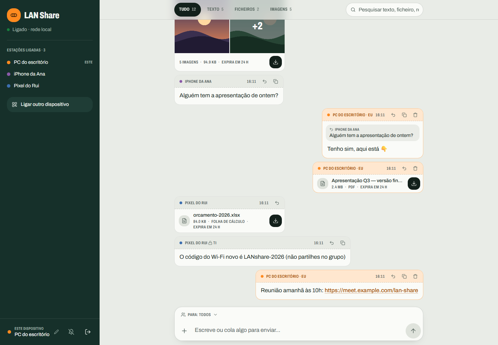
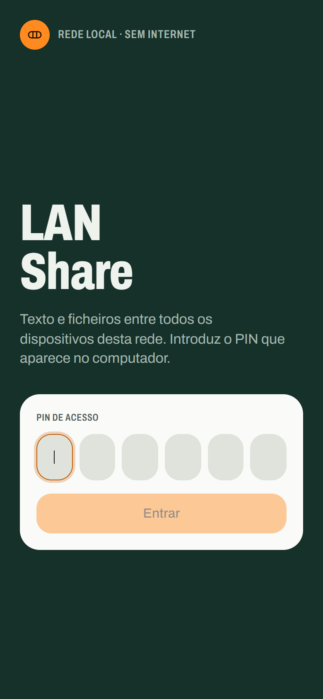
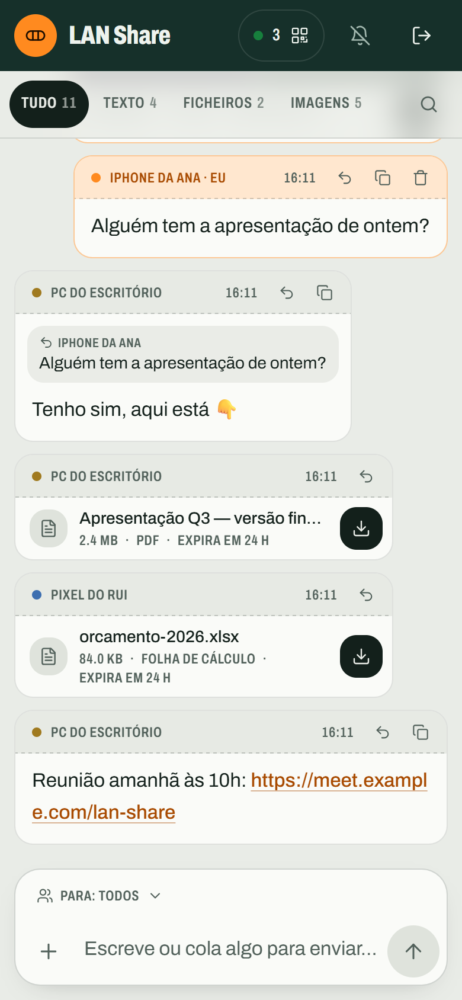
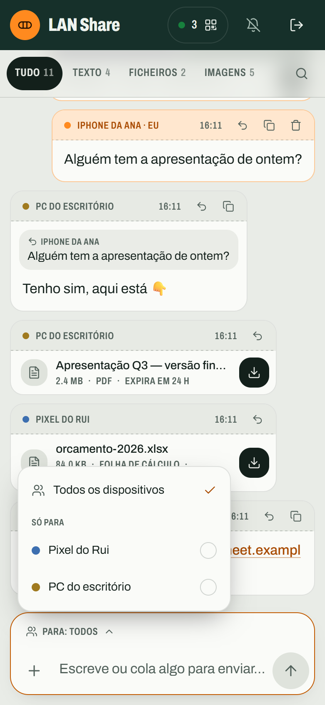
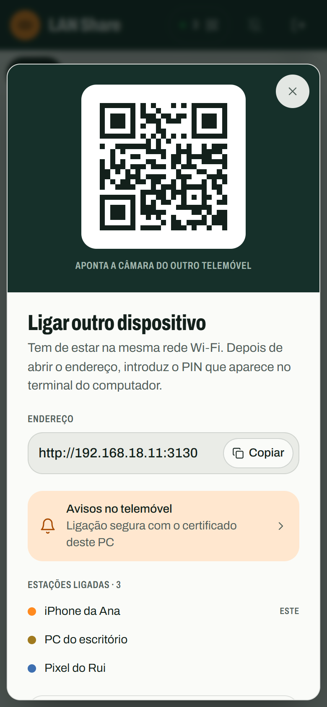
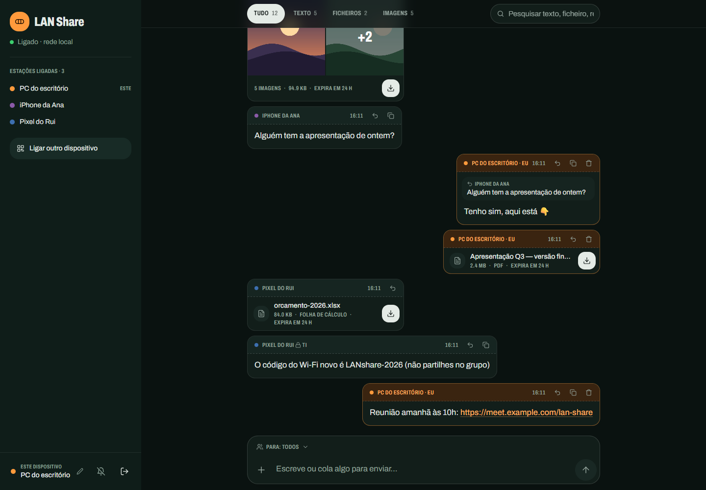
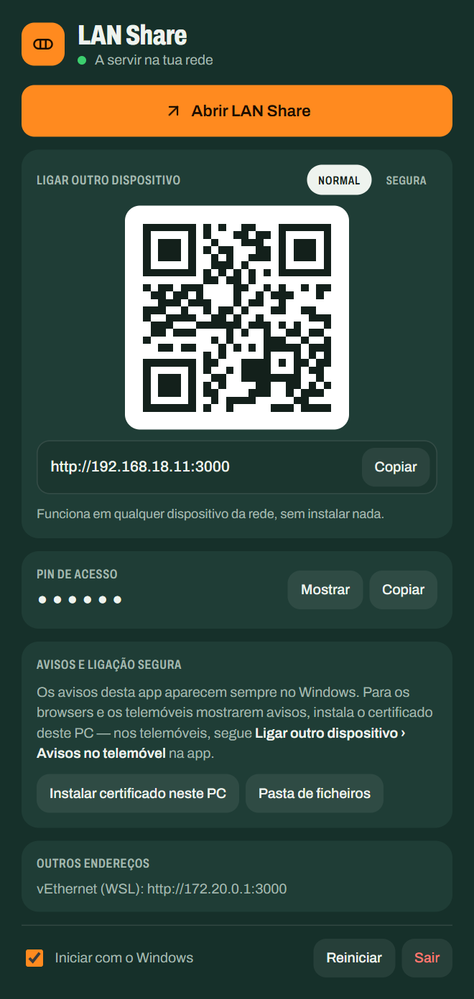
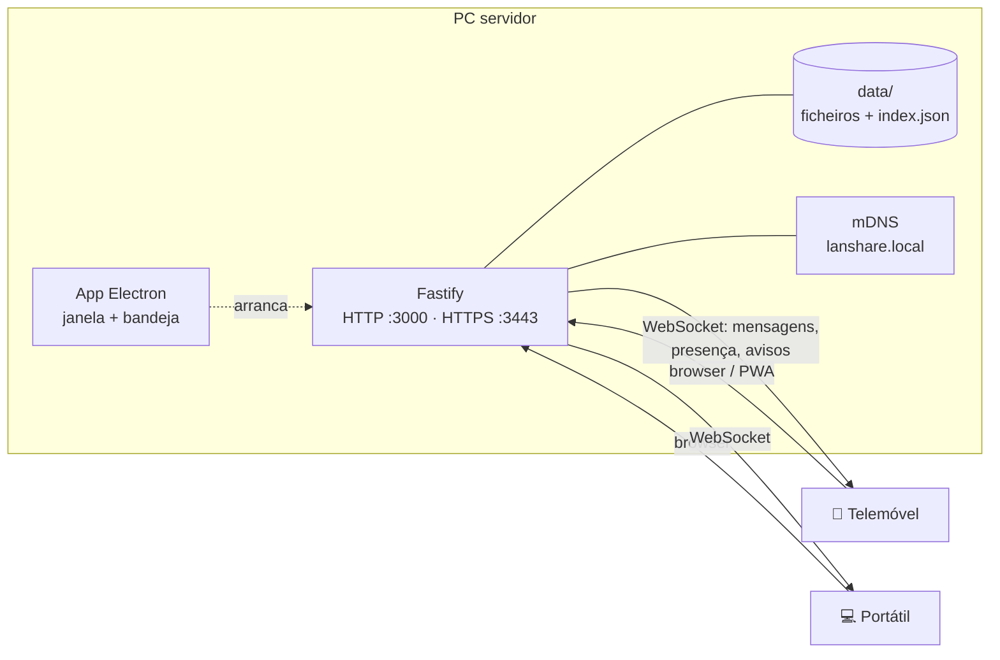

<div align="center">


# LAN Share

**Texto e ficheiros entre todos os dispositivos da mesma rede — 100% offline.**
<br />
Sem internet, sem contas, sem cabos. Um PC faz de servidor; qualquer telemóvel entra pelo browser.

[](https://nodejs.org)
[](https://www.typescriptlang.org)
[](https://react.dev)
[](https://fastify.dev)
[](https://vite.dev)
[](https://tailwindcss.com)
[](https://www.electronjs.org)
[](#usar)
[](LICENSE)



</div>

## O que faz

Um dispositivo (PC Windows, Linux ou Mac) serve a rede Wi‑Fi ou cabo; os outros abrem o endereço no browser (Chrome, Edge, Safari) e participam. Os ficheiros vão **diretamente do telemóvel para o disco do PC** — nunca passam por um servidor externo.

| | |
| --- | --- |
| 💬 **Tempo real** | Texto por WebSocket, com links clicáveis e botão de copiar |
| 📁 **Ficheiros até 2 GB** | Barra de progresso, pré-visualização de imagens, expiração visível («expira em 3 h») |
| 🖼️ **Álbuns** | Várias fotos seguidas agrupam-se em grelha, como no WhatsApp, com visualizador e setas |
| 🔒 **Só para alguns** | Escolhe a quem enviar; o servidor só entrega a esses dispositivos |
| ↩️ **Responder e apagar** | Citações com salto para o original; quem enviou apaga para todos |
| 📇 **Quem está ligado** | Cada dispositivo tem nome e cor; lista de estações em tempo real |
| 🔎 **Filtros e pesquisa** | Tudo / Texto / Ficheiros / Imagens, galeria e pesquisa com destaque |
| 🔔 **Avisos** | Contagem no separador, som e avisos do sistema (HTTPS próprio) |
| 📱 **QR e PWA** | QR com o endereço da rede; instalável no ecrã principal |
| 🖥️ **App para Windows** | Janela + ícone na bandeja, avisos nativos, instalador e versão *portable* |
| 🧹 **Arruma-se sozinha** | Ficheiros expiram ao fim de 24 h (configurável); nunca enche o disco |

## Capturas

<table>
  <tr>
    <td align="center" width="25%"><br /><sub><b>Entrar com o PIN</b></sub></td>
    <td align="center" width="25%"><br /><sub><b>Feed no telemóvel</b></sub></td>
    <td align="center" width="25%"><br /><sub><b>Enviar só para alguns</b></sub></td>
    <td align="center" width="25%"><br /><sub><b>Ligar por QR</b></sub></td>
  </tr>
</table>

<table>
  <tr>
    <td width="66%"><br /><sub><b>Modo escuro</b> — segue o sistema</sub></td>
    <td width="34%"><br /><sub><b>App para Windows</b> — painel do servidor</sub></td>
  </tr>
</table>

O visual chama-se **correio pneumático**: cada envio é uma cápsula com a sua guia (remetente · hora), o casco verde-esmalte enquadra e o âmbar marca o que é acionável e o que é teu. As regras completas estão em [`DESIGN.md`](DESIGN.md).

## Stack

| Camada | Tecnologia | Para quê |
| --- | --- | --- |
| Servidor | **Node.js 24** + **Fastify 5** | HTTP/HTTPS, uploads em *stream*, ficheiros com `Range`; o Node 24 corre `.ts` diretamente |
| Tempo real | **WebSocket** (`@fastify/websocket`) | Mensagens, presença e apagados; reconexão com *backoff* |
| Cliente | **React 19** + **Vite 8** | SPA leve; fonte **Archivo** variável empacotada (funciona offline) |
| Estilo | **Tailwind CSS 4** | Tokens claro/escuro do design «correio pneumático» |
| App de PC | **Electron 44** + electron-builder | Janela, bandeja, avisos nativos do Windows, instalador NSIS e *portable* |
| HTTPS local | **node-forge** + **multicast-dns** | Autoridade de certificação própria e o nome `lanshare.local` |
| Segurança | Helmet (CSP), rate-limit, cookies `HttpOnly` | PIN de 6 dígitos com bloqueio após tentativas falhadas |
| Qualidade | TypeScript estrito + `node:test` | 28 testes de integração (rotas, WebSocket, privacidade, TLS) |



## Usar

```bash
npm install
npm run build   # compila o cliente (uma vez)
npm start
```

O terminal mostra o PIN e os endereços:

```
PIN de acesso (mostra aos telemóveis)   ← os convidados precisam disto
── Abre a LAN Share noutro telemóvel em: ──
http://192.168.x.x:3000                  ← um URL por interface + QR
── HTTPS (avisos nos telemóveis): https://lanshare.local:3443 ──
```

Nos telemóveis (mesma rede Wi‑Fi): ler o QR ou abrir o URL, escrever o PIN e começar. Para instalar como app: **Adicionar ao ecrã principal** (Android) ou **Partilhar › Adicionar ao ecrã principal** (iOS).

## App para Windows

Para quem não programa: a LAN Share também corre como app de ambiente gráfico. Abre a **própria LAN Share numa janela** (já com sessão iniciada) e fica na bandeja do sistema. Com a janela fechada ou minimizada, cada envio novo aparece como **aviso nativo do Windows**. O painel do servidor (QR, endereço, PIN, certificado) abre-se pela bandeja em *Servidor (PIN e QR)*.

```bash
npm install
npm run build && npm run build:server
npm run app        # modo de desenvolvimento
npm run app:dist   # instaladores em release/: ...-instalador.exe e ...-portable.exe
```

O instalador cria atalhos no Menu Iniciar e no ambiente de trabalho e tem desinstalador; a versão *portable* não instala nada. Quem instala não precisa de Node.

| Onde fica | Caminho |
| --- | --- |
| Ficheiros recebidos | `%APPDATA%\LAN Share\data\Ficheiros` |
| Índice de mensagens | `%APPDATA%\LAN Share\data\index.json` |
| Certificados HTTPS | `%APPDATA%\LAN Share\data\tls` |

- Escolhe portas livres a partir de `3000` (HTTP) e `3443` (HTTPS).
- Fechar a janela **não** para o servidor nem os avisos; fecha-se em *Sair* (painel ou bandeja).
- **Iniciar com o Windows** arranca escondida na bandeja, e os avisos continuam a chegar.
- O PIN muda a cada arranque e aparece no painel e em *Ligar outro dispositivo*.

## HTTPS e avisos nos telemóveis

Os browsers só mostram avisos do sistema em ligações seguras. Por isso o servidor também serve **HTTPS na porta `3443`** com um certificado próprio, sem internet:

- Na primeira execução cria uma autoridade local (`data/tls/ca.key` + `ca.crt`, 10 anos) que assina o certificado do servidor (397 dias, renovado sozinho quando o IP muda ou a validade acaba). **A chave da autoridade nunca deve sair do computador.**
- Anuncia **`lanshare.local`** por mDNS (iPhone, Mac e Windows resolvem; alguns Android precisam do IP).
- Cada dispositivo instala o certificado **uma vez**: na app, *Ligar outro dispositivo › Avisos no telemóvel* mostra os QR (certificado em `http://<ip>:3000/ca.crt` e endereço seguro) e os passos para iPhone, Android e PC. Na app para Windows há o botão *Instalar certificado neste PC*.
- O HTTP na porta `3000` continua a funcionar para quem não instalar nada.
- Com o browser fechado ou o ecrã bloqueado não há avisos: isso exigiria os servidores de notificações da Apple/Google (internet).

## Configuração (variáveis de ambiente)

| Variável | Padrão | Descrição |
| --- | --- | --- |
| `PORT` | `3000` | Porta HTTP |
| `HOST` | `0.0.0.0` | Interface a escutar |
| `PIN` | gerado | Código de acesso (6 dígitos) |
| `MAX_FILE_MB` | `2048` | Tamanho máximo por ficheiro |
| `RETENTION_HOURS` | `24` | Vida útil dos ficheiros; `0` = nunca apagar |
| `MAX_TEXT_LEN` | `2000` | Máximo de texto por mensagem |
| `HISTORY_LIMIT` | `50` | Mensagens que um novo visitante recebe |
| `MIN_FREE_DISK_MB` | `512` | Recusa uploads se o disco ficar abaixo disto |
| `SWEEP_INTERVAL_MIN` | `5` | Frequência da limpeza de expirados (≥1) |
| `UPLOAD_DIR` | `./data/files` | Onde ficam os ficheiros |
| `TLS` | `1` | `0` desliga o HTTPS (fica só HTTP) |
| `HTTPS_PORT` | `PORT + 443` | Porta HTTPS |
| `MDNS_NAME` | `lanshare` | Nome anunciado na rede (`<nome>.local`) |

Há um exemplo comentado em [`.env.example`](.env.example).

## Desenvolvimento

```bash
npm run dev:client  # Vite em :5173 (proxy para o servidor em :3000)
npm run dev         # servidor com --watch (o Node 24 executa .ts direto)
npm test            # testes de integração
npm run typecheck   # TypeScript estrito (servidor + cliente)
npm run icons       # regenera os ícones PWA
npm run icons:app   # regenera build/icon.ico e build/tray.ico
```

```
client/      React + Vite (src/components, src/lib, public/sw.js)
server/      Fastify: rotas, WebSocket, store, TLS e mDNS (+ testes em server/test)
electron/    app de PC: processo principal, painel do servidor e preloads
scripts/     geração de ícones e teste de carga
docs/        capturas usadas neste README
```

Com `LANSHARE_IPC=1` (é o que a app faz), o servidor escreve na stdout uma linha `LANSHARE_IPC {json}` com endereços, PIN e certificado — é assim que o painel sabe o que mostrar.

## Segurança

- **Só para a rede local**: o servidor escuta em `0.0.0.0` para ser alcançável na LAN, mas **não** está preparado para a internet. Nunca faças *port-forwarding* nem o alojes numa cloud.
- Sessão por cookie `HttpOnly`/`SameSite=strict` (12 h); sem cookie → `401`.
- Rate-limit global e bloqueio temporário do PIN após tentativas falhadas.
- CSP via Helmet; nomes de ficheiro sanitizados; nada do que é enviado é executado.
- O nome de cada dispositivo é local e não autenticado: os envios «só para» e o «apagar» protegem contra enganos entre quem já tem o PIN, não contra quem se faça passar por outro dispositivo.

## Dicas de rede

- Se o telemóvel não liga, confirma que está na **mesma rede** que o PC (Wi‑Fi ou hotspot) e que o «isolamento entre clientes» do router está desligado (alguns routers de hotel ou de operadora bloqueiam dispositivos entre si).
- Os IPs mudam com o DHCP: o endereço e o certificado atualizam-se sozinhos; `lanshare.local` evita ter de decorar o IP.
- Usa o browser do telemóvel — não é preciso instalar nada.

## Limitações conhecidas

- Correr pelo terminal requer Node.js ≥ 24 no PC servidor (a app para Windows traz o seu próprio).
- Sem encriptação de ponta a ponta: o HTTPS protege o caminho até ao PC, que guarda os ficheiros em claro.
- Pré-visualização inline só para imagens (≤ 20 MB); o QR no terminal fica melhor no Windows Terminal ou no VS Code.

## Licença

[MIT](LICENSE)
